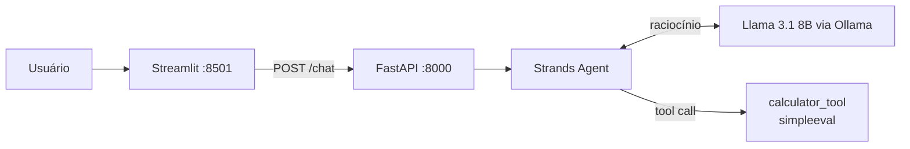

# ☁️ DreamBOT - Agente de IA

[](https://github.com/Athurgomes/DreamBOT-Math_Agent/actions/workflows/ci.yml)


-000000)

Este projeto consiste em uma **API de Agente de IA** desenvolvida com **FastAPI**, capaz de interpretar linguagem natural e executar ferramentas matemáticas. A solução integra um LLM local (**Ollama**) com o **Strands Agents SDK** e possui uma interface de chat interativa desenvolvida em **Streamlit**.

> **Destaques:** Arquitetura limpa (Clean Architecture), execução via Docker, proteção contra execução de código malicioso (`simpleeval`) e refinamento de Prompt.



---

## Pré-requisitos

Antes de executar, certifique-se de ter o **Ollama** configurado na sua máquina (Host), pois o agente utiliza o processamento local.

1. **Instale o Ollama**: [ollama.com](https://ollama.com/)
2. **Baixe o modelo Llama 3.1**:
   ```bash
   ollama pull llama3.1:8b
   ```
3. Mantenha o Ollama rodando em segundo plano.

---

## Configuração Inicial (.env)

O projeto utiliza variáveis de ambiente para alternar entre execução Local e Docker.

1. Duplique o arquivo `.env.example`
2. Renomeie a cópia para `.env`
3. Ajuste as variáveis conforme o **modo de execução** escolhido abaixo (Docker ou Local)

---

## Como Executar

Você pode rodar a aplicação completa via Docker (Recomendado) ou apenas o Backend localmente para testes rápidos.

### Opção A: Rodar Completo com Docker (Backend + Frontend)

Esta opção sobe a API e a Interface Visual automaticamente.

1. **Configure o `.env` para Docker**:
   Abra seu arquivo `.env` e garanta que `OLLAMA_HOST` aponte para o gateway do Docker:

   ```ini
   OLLAMA_HOST=http://host.docker.internal:11434
   API_URL=http://backend:8000
   ```

2. **Execute o comando**:
   Na raiz do projeto, execute:

   ```bash
   docker-compose up --build
   ```

3. **Acesse**:
   - **Frontend (Chat):** [http://localhost:8501](http://localhost:8501)
   - **Backend (API):** [http://localhost:8000](http://localhost:8000)

### Opção B: Rodar Somente Backend (Localmente)

Use esta opção para desenvolvimento rápido ou testes de API via Postman/Swagger.

1. **Instale as dependências**:
   Requer Python 3.13+.

   ```bash
   pip install -r requirements.txt
   ```

2. **Configure o `.env` para Local**:
   Abra seu arquivo `.env` e use `localhost`:

   ```ini
   OLLAMA_HOST=http://localhost:11434
   API_URL=http://localhost:8000
   ```

3. **Inicie o Servidor**:
   Execute o comando apontando para o módulo dentro da pasta `app`:

   ```bash
   uvicorn app.main:app --reload
   ```

4. **Teste a API**:
   - **Swagger UI (Docs):** [http://localhost:8000/docs](http://localhost:8000/docs)
   - **Health Check:** [http://localhost:8000/health](http://localhost:8000/health)

---

## Testando a API (Postman)

Para testar o raciocínio do Agente diretamente na API:

**Endpoint:** `POST /chat`  
**URL:** `http://localhost:8000/chat`  
**Headers:** `Content-Type: application/json`

**Exemplo de Payload (Cálculo):**
```json
{
  "message": "Qual a raiz quadrada de 144?"
}
```

**Exemplo de Payload (Conceitual):**
```json
{
  "message": "O que é uma API?"
}
```

---

## Testes

Os testes não precisam do Ollama: o agente é simulado e a calculadora é testada diretamente, inclusive contra tentativas de injeção de código.

```bash
pip install -r requirements.txt -r requirements-dev.txt
pytest -q
ruff check app tests
```

O CI roda lint, testes e o build da imagem Docker a cada push.

---

## Decisões de Arquitetura

- **Estrutura Modular:** O código foi organizado dentro do pacote `app/` separando responsabilidades:
  - `agent.py`: Fábrica do Agente e configuração do modelo
  - `tools/calculator.py`: Ferramenta matemática segura usando `simpleeval` (evita `eval` inseguro)
  - `prompts/`: Gerenciamento de System Prompts
- **Prompt Engineering:** Utilização de *Few-Shot Prompting* para garantir que o modelo responda de forma direta e profissional
- **Docker:** Configurado com *Healthchecks* para garantir que o Frontend só inicie após o Backend estar pronto

---

## Estrutura de Arquivos

```
/
├── app/
│   ├── main.py           # Entrypoint da API FastAPI
│   ├── agent.py          # Configuração do Agente Strands + Ollama
│   ├── app_ui.py         # Frontend Streamlit
│   ├── tools/            # Ferramentas personalizadas (Calculadora)
│   └── prompts/          # Arquivos de texto para System Prompts
├── docker-compose.yaml   # Orquestração dos containers
├── Dockerfile            # Imagem Python 3.13-slim otimizada
├── tests/                # Testes da API e da calculadora
├── requirements.txt      # Dependências de runtime
├── requirements-dev.txt  # Dependências de desenvolvimento (pytest, ruff)
├── .env                  # Variáveis de ambiente
└── README.md             # Documentação
```
